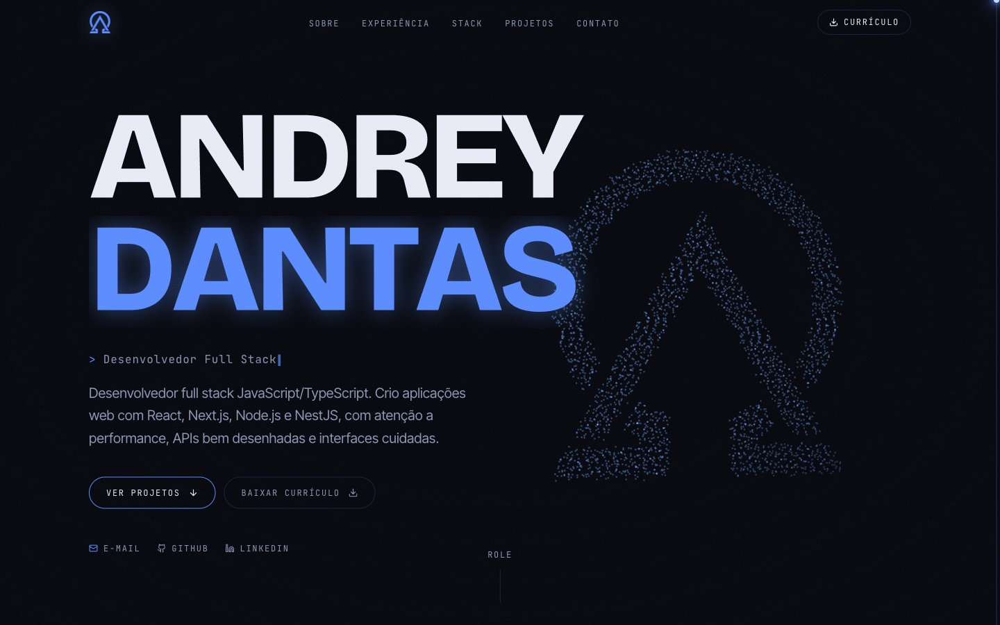
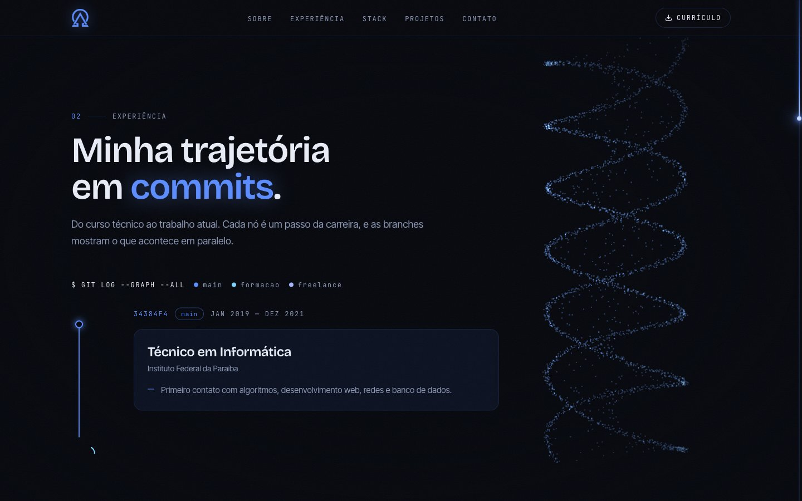
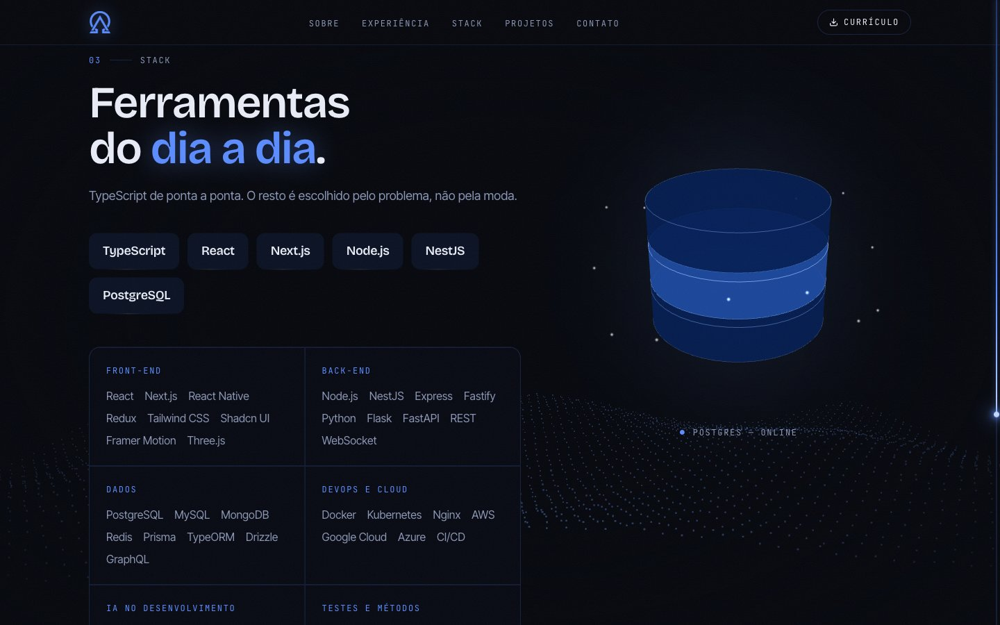
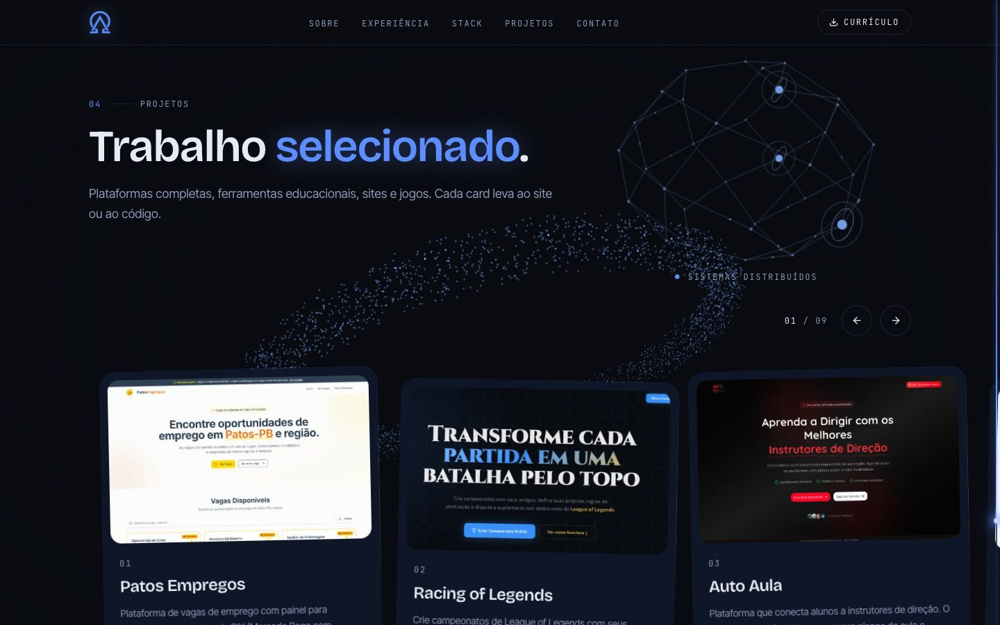
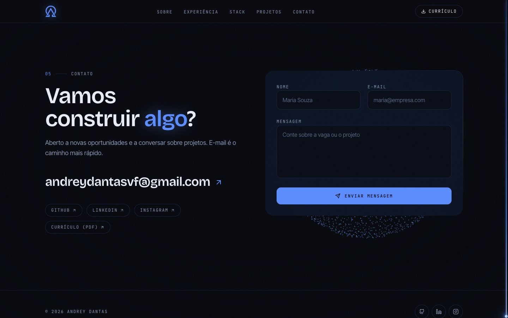
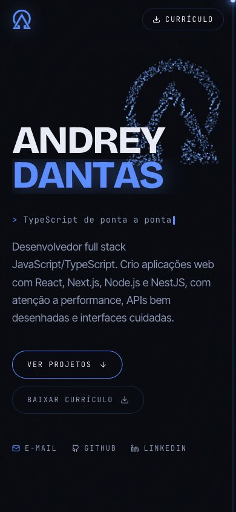

# Andrey Dantas · Portfólio

Portfólio de desenvolvedor full stack JavaScript/TypeScript. Mostra experiência, stack e projetos num site escuro e interativo, com um campo de partículas em three.js que muda de forma conforme a página rola.

**[andreydantas.com.br](https://andreydantas.com.br)**



## Destaques

- **Campo de partículas que acompanha o scroll.** Um único canvas three.js fica fixo atrás da página. Cada seção declara uma forma (`data-particles`) e as partículas migram entre elas: o logo pontilhado no hero, uma hélice dupla na experiência, uma onda na stack, um anel nos projetos.
- **Experiência como árvore do git.** A carreira é desenhada como um `git log --graph`, com as branches `main`, `formacao` e `freelance` e animação de curva, nó e card ao rolar.
- **Objetos 3D por seção.** Rack de servidor, banco de dados e rede distribuída, renderizados só quando estão visíveis.
- **Movimento cuidado.** Scroll suave com Lenis sincronizado ao GSAP ScrollTrigger, barra de rolagem própria que se enche de luz e cursor em mira. Com `prefers-reduced-motion`, tudo isso é desligado.
- **Contato direto.** Formulário com EmailJS e currículo em PDF para download.

## Telas

| Experiência | Stack |
| --- | --- |
|  |  |
| **Projetos** | **Contato** |
|  |  |

<p align="center">
  
</p>

## Stack

| | |
| --- | --- |
| Framework | Next.js 16 (App Router), React 19, TypeScript |
| Estilo | Tailwind CSS 4 |
| 3D e animação | three.js, React Three Fiber, drei, GSAP + ScrollTrigger, Lenis |
| Integrações | EmailJS (formulário), API pública de contribuições do GitHub, Google Analytics |

## Estrutura

```
src/
  app/          layout, página e tokens de cor/tipografia (globals.css)
  data/         conteúdo: site, experiência, stack e projetos
  components/
    shell/      header, footer, scroll suave, barra de rolagem e cursor
    three/      campo de partículas e objetos 3D
    sections/   Hero, Sobre, Experiência, Stack, Projetos e Contato
    ui/         componentes de base
```

Textos, projetos e experiência ficam em `src/data/`, separados da apresentação. Para adicionar um projeto, basta incluir um item em `src/data/projects.ts` e a imagem em `public/projects/`.

## Como rodar

Pré-requisitos: Node.js 20+ e [pnpm](https://pnpm.io/).

```bash
git clone https://github.com/andreydantasvf/my-portfolio.git
cd my-portfolio
pnpm install
cp .env.example .env.local   # preencha as chaves
pnpm dev
```

O site abre em http://localhost:3000.

### Variáveis de ambiente

| Variável | Uso |
| --- | --- |
| `NEXT_PUBLIC_EMAILJS_SERVICE_ID`, `NEXT_PUBLIC_EMAILJS_TEMPLATE_ID`, `NEXT_PUBLIC_EMAILJS_PUBLIC_KEY` | Envio do formulário de contato |
| `NEXT_PUBLIC_GA_TRACKING` | Google Analytics (opcional) |

### Scripts

| Comando | O que faz |
| --- | --- |
| `pnpm dev` | Servidor de desenvolvimento (Turbopack) |
| `pnpm build` / `pnpm start` | Build e servidor de produção |
| `pnpm lint` | ESLint |
| `pnpm format` | Prettier |

## Contato

- E-mail: andreydantasvf@gmail.com
- LinkedIn: [linkedin.com/in/andreydantasvf](https://linkedin.com/in/andreydantasvf)
- GitHub: [github.com/andreydantasvf](https://github.com/andreydantasvf)
